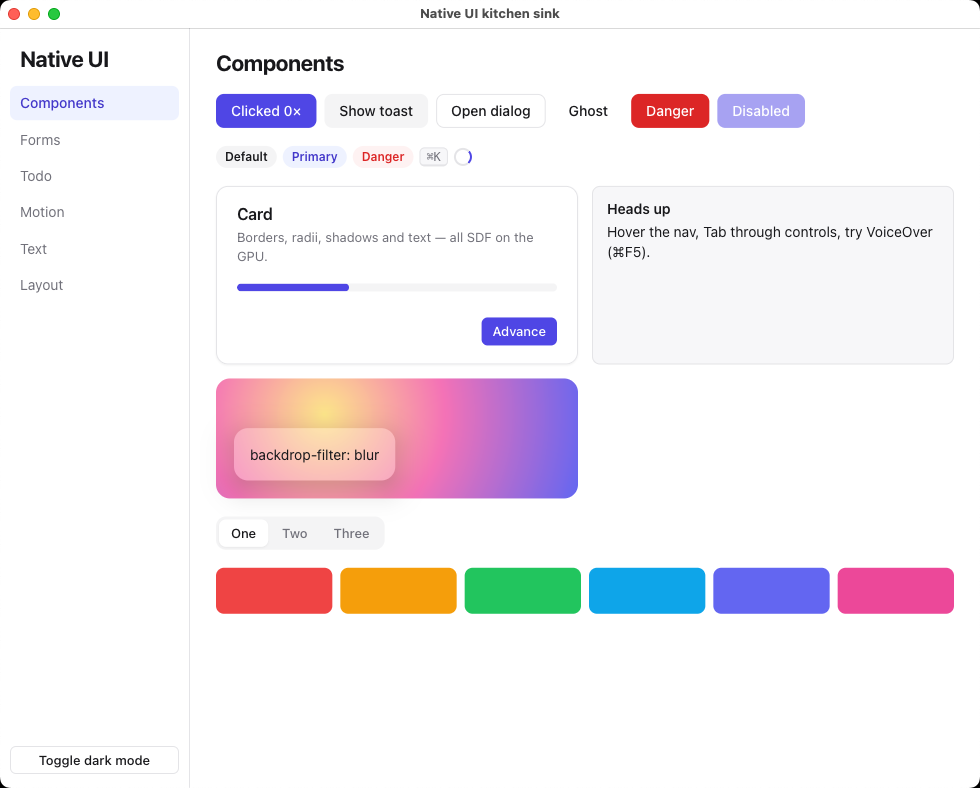
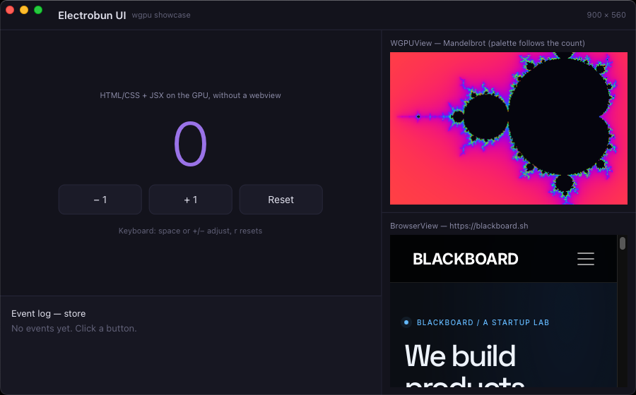

import { Aside } from "@astrojs/starlight/components";

<Aside type="caution" title="Experimental">
Electrobun UI is experimental on macOS, Windows, and Linux (X11), on x64 and
ARM64. APIs may change between releases, including stable Electrobun releases.
See [current limitations](#current-limitations).
</Aside>

Electrobun UI renders HTML, CSS, and JSX directly to the GPU from your main
process. There is no webview and no browser engine: a small UI engine written
in Zig parses your markup and CSS, runs layout and text shaping, and draws the
result with instanced SDF quads through Dawn (WebGPU). Your app code drives it
with fine-grained reactivity, so an update touches exactly the nodes that
changed.



*Kitchen Sink on macOS: HTML/CSS components rendered directly by the native
GPU UI engine.*

```text
your JSX + signals/stores (electrobun/main/ui)
        ↓  one DOM mutation per changed binding, batched over FFI
Zig UI core: DOM → CSS cascade → layout → text → paint
        ↓
instanced SDF quads → Dawn surface (WGPUView)
```

Rendering is invalidation-driven: style, layout, and paint only run when
something changed, and frames are only presented while something is
animating or invalidated. An unchanged, idle window does not continuously
repaint.

## A stable subset, not a browser

The engine implements a practical subset of HTML and CSS — the parts app UIs
actually use — and aims to keep that subset stable rather than chase browser
compatibility. Flexbox, grid, positioning, the cascade with `@layer`,
`var()`, nesting, media queries, transitions, keyframes, shadows, gradients,
filters and `backdrop-filter`, form controls, text editing, and IME all work,
and Tailwind v4 output styles correctly. Some browser features are
deliberately absent (floats, real tables, web fonts, network images). The
[HTML & CSS reference](/electrobun/apis/ui/html-css/) lists exactly what is
supported.

The same components and CSS also work in a regular webview through the
[DOM renderer](/electrobun/apis/ui/browser-dom/), so you can move a view
between a GPU window and a webview without rewriting it.

## Hello world

The fastest start is a template:

```bash
hutch electrobun init my-app --template=bun-ui      # Bun main process
hutch electrobun init my-app --template=zig-ui      # Zig main process
```

To set it up by hand, enable `bundleWGPU` for each target OS. It bundles Dawn
and the platform UI engine library into the app. Electrobun UI works with
the Bun and Cottontail main processes; this example uses Bun:

```ts
// electrobun.config.ts
import type { ElectrobunConfig } from "electrobun";

export default {
  app: { name: "hello-ui", identifier: "hello-ui.example.com", version: "0.0.1" },
  build: {
    mainProcess: "bun",
    bun: { entrypoint: "src/main.tsx" },
    mac: { bundleCEF: false, bundleWGPU: true },
    win: { bundleCEF: false, bundleWGPU: true },
    linux: { bundleCEF: false, bundleWGPU: true },
  },
} satisfies ElectrobunConfig;
```

Tell TypeScript which JSX runtime to use. This is type-checking
configuration only — the transpiler already handles `.tsx`:

```jsonc
// tsconfig.json
{ "compilerOptions": { "jsx": "react-jsx", "jsxImportSource": "electrobun/main/ui" } }
```

Then write ordinary HTML-flavoured JSX and CSS:

```tsx
// src/main.tsx
import { createUIWindow, live, signal } from "electrobun/main/ui";

const css = `
  body { margin: 0; height: 100vh; display: grid; place-items: center; }
  .count { font-size: 32px; font-weight: 600; }
`;

function Counter() {
  const [count, setCount] = signal(0);
  return (
    <div class="eb-col" style="gap: 16px; align-items: center">
      <div class="count">{live(() => `Count: ${count()}`)}</div>
      <button class="eb-btn" onClick={() => setCount((c) => c + 1)}>Click me</button>
    </div>
  );
}

createUIWindow(
  { title: "Hello UI", width: 420, height: 260, css, components: true },
  () => <Counter />,
);
```

Run it with `hutch electrobun dev`. `components: true` adds the built-in
[`eb-*` component stylesheet](/electrobun/apis/ui/components/); everything
else is plain CSS you write.

Three rules cover the programming model:

- **Reactivity is explicit.** `live(() => ...)` is a reactive binding that
  updates exactly one thing when its dependencies change. Unmarked values are
  static. See [Reactivity](/electrobun/apis/ui/reactivity/).
- **Components are plain functions** called once — no re-rendering, no hooks
  rules.
- **Handlers are plain functions** (`onClick={() => ...}`) and are never
  tracked.

## Templates

| Template | Main process | Shows |
| --- | --- | --- |
| `bun-ui` | Bun | a starter app: components, forms, reactive state |
| `zig-ui` | Zig | driving the UI engine from a Zig main process |
| `ui-launcher` | Cottontail | transparent always-on-top command palette, global shortcut, keyed list, text input |
| `ui-color-picker` | Cottontail | tray eyedropper in a transparent rounded window |
| `ui-wgpu` | Cottontail | UI with an embedded custom WGPU render and webview |

## Mixing in native views

The UI owns one full-window Dawn view. Native views — your own
[`WGPUView`](/electrobun/apis/webgpu/) render loop, or a webview — can be
positioned over elements so they participate in the layout; see
[anchoring native views](/electrobun/apis/ui/overview/#anchoring-native-views).
To put Electrobun UI *inside* web content instead, use the
[`<electrobun-ui>` tag](/electrobun/apis/ui/ui-tag/).



*The `ui-wgpu` template on macOS combines GPU-rendered app controls, a custom
WebGPU scene, and a native webview anchored to the UI layout.*

## Migrating from the 2.0.5 prototype

Electrobun 2.0.6 replaces the experimental UI prototype with the Zig HTML/CSS
engine. Apps using ordinary webviews do not need to change. Apps that used
the experimental `electrobun/main/ui` renderer should migrate their markup
and mounting code:

| Prototype API | Current API |
| --- | --- |
| `<box>`, `<row>`, `<column>`, `<text>`, `<spacer>` and layout props | HTML elements with CSS; use `.eb-row` / `.eb-col` for simple flex containers and `flex-grow` for spacers. |
| `textInput` | Native HTML `<input>` and `<textarea>` with DOM input events. |
| `webview` / `wgpuSurface` components | Create a `BrowserView` or `WGPUView` and position it with `ui.anchor(element, view)`. |
| `createUiContext`, `getUiContext`, `onKey` | The `UI` instance and DOM event listeners, such as `onKeyDown`. |
| `UiTree` and low-level layout/paint helpers | `UI.document`, `UIDocument`, and `UINode`; layout and rendering now live in the Zig engine. |
| `mount.context`, `mount.closed`, `mount.isClosed()` | Access `mount.ui`; observe window closure with `mount.window.on("close", ...)`. |

The reactivity model remains explicit: `signal`, `store`, `live`, `memo`,
and the control-flow components still drive individual bindings. The native
renderer now shares its HTML/JSX renderer with
[`electrobun/browser/ui`](/electrobun/apis/ui/browser-dom/). The mounting
signatures and node interfaces have changed; use the
[API overview](/electrobun/apis/ui/overview/) and updated templates as the
reference when migrating.

## Where to go next

- [API overview](/electrobun/apis/ui/overview/) — windows, mounting, the `UI`
  object, testing helpers.
- [HTML & CSS](/electrobun/apis/ui/html-css/) — the supported subset.
- [Components](/electrobun/apis/ui/components/) — the `eb-*` design system.
- [Reactivity](/electrobun/apis/ui/reactivity/) — signal, store, live, memo.
- [Events & input](/electrobun/apis/ui/events/) — pointer, keyboard, focus,
  text editing, accessibility.
- [Zig](/electrobun/apis/ui/zig/) — using the engine from a Zig main process.

## Current limitations

- **Platform differences:** Linux uses X11, has no native assistive-technology
  bridge yet, and should not rely on transparent UI surfaces. See
  [platform support](/electrobun/apis/ui/overview/#platform-support).
- **Fonts:** system fonts only. `@font-face` rules are parsed but web fonts
  are not loaded. The portable Windows/Linux text backend does not yet
  implement bidirectional reordering, complex Arabic/Indic shaping, or
  variable-font instances.
- **Images:** `` loads `data:` URLs and file paths; there is no network
  loading. Inline `<svg>` is rasterized.
- **Layout gaps:** no floats; `position: sticky` behaves like `relative`;
  tables lay out as flex rows; transforms are 2D.
- **Dark mode** follows the `dark` option / `ui.setDark()`, not the system
  appearance automatically.
- Electrobun UI runs in the privileged main process — use it for trusted app
  UI, not untrusted content (that is what webviews are for).
